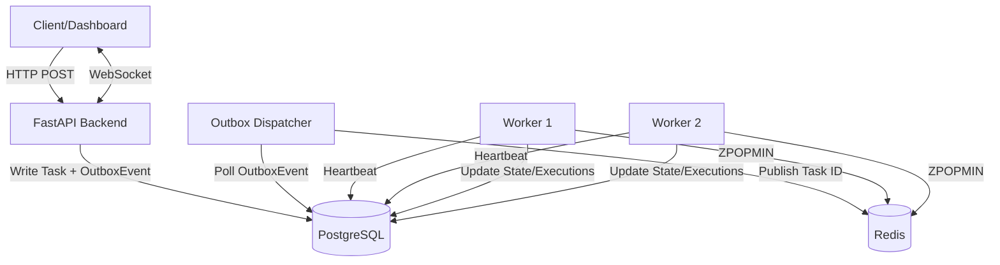

# Fault-Tolerant Distributed Task Queue

## 1. Overview
This project is a high-performance, fault-tolerant distributed task queue designed to execute asynchronous background jobs reliably. It bridges a persistent PostgreSQL source-of-truth with a high-throughput Redis coordination layer using the Transactional Outbox pattern. The system ensures robust execution with features like lease-based worker ownership, priority scheduling, and comprehensive failure recovery mechanisms including exponential backoff and dead-lettering. A real-time React dashboard is provided to monitor cluster health, queue depths, and task lifecycle events via WebSockets.

## 2. Core Features
- **Asynchronous task submission:** Instantly offload long-running operations.
- **Strict priority scheduling:** Execute tasks in order of `CRITICAL` (0), `HIGH` (1), `NORMAL` (2), and `LOW` (3) priorities.
- **FIFO within priority:** Guarantees chronological execution within priority bands.
- **Multiple workers:** Independently scalable worker containers for concurrent processing.
- **Transactional outbox:** Atomic commit of task data and publishing events prevents dual-write inconsistencies.
- **Redis queue coordination:** Ephemeral, high-throughput coordination using Redis Sorted Sets.
- **Lease-based ownership:** Atomic `ZPOPMIN` task claiming combined with TTL leases prevents double execution.
- **Heartbeat monitoring:** Workers periodically pulse health, allowing the system to detect and recover from crashed nodes.
- **Worker crash recovery:** Tasks belonging to dead workers are automatically reclaimed and re-queued with their original priority intact.
- **Retry and exponential backoff:** Automatically retries failing tasks with a jittered exponential backoff algorithm.
- **Dead-letter queue:** Hard-failing tasks are safely parked for inspection after exhausting retry limits.
- **Cooperative cancellation:** Active and queued tasks can be gracefully interrupted and cancelled.
- **REST API:** Clean, fully-documented FastAPI interface.
- **WebSocket events:** Real-time push notifications of task state transitions and worker metrics.
- **Real-time monitoring dashboard:** React + TypeScript frontend providing a live overview of system health.
- **Dockerized deployment:** 1-click execution via Docker Compose.

## 3. Architecture
The architecture is designed around the principle that persistent state lives only in PostgreSQL, while Redis handles transient scheduling and high-throughput inter-process coordination.



## 4. Technology Stack
- **Python** (Backend Logic)
- **FastAPI** (REST API & WebSockets)
- **PostgreSQL** (Persistent Datastore)
- **Redis** (Queue & Pub/Sub)
- **SQLAlchemy** (Async ORM)
- **Alembic** (Database Migrations)
- **React 19 & TypeScript** (Monitoring UI)
- **Docker & Docker Compose** (Containerization & Orchestration)
- **Pytest** (Automated Testing Framework)

## 5. Task Lifecycle
Tasks flow through a strictly enforced state machine:

- `PENDING`: Task is securely saved to PostgreSQL but not yet available in Redis.
- `QUEUED`: Task has been published to Redis and is awaiting a worker.
- `RUNNING`: A worker has atomically claimed the task and acquired a lease.
- `COMPLETED`: Execution was successful.
- `FAILED`: Execution threw an error and will be retried (returns to `QUEUED`).
- `DEAD_LETTER`: Execution failed permanently after exhausting retries.
- `CANCEL_REQUESTED`: An interruption signal was sent to a `RUNNING` task.
- `CANCELLED`: Task was intentionally stopped and will not proceed.

## 6. Reliability Model
The system is built on **at-least-once delivery/processing semantics**.

1. **Transactional Outbox:** The REST API writes the `Task` and an `OutboxEvent` in a single PostgreSQL transaction. A separate `outbox-dispatcher` reads the outbox and publishes the task to Redis. This ensures no task is ever dropped due to a temporary Redis outage.
2. **Leases:** Workers claim tasks by acquiring a temporary lease. If a worker dies while processing (`RUNNING`), the lease will expire.
3. **Heartbeats:** Workers constantly report their health.
4. **Failure recovery:** Any healthy worker can detect an expired lease from a dead worker and safely return the task to the queue. 
5. **Duplicate execution:** Because of the at-least-once guarantee (and network partitions), duplicate execution is *theoretically possible* but extremely rare. Tasks should ideally be idempotent.

## 7. Installation & Docker Setup

### Prerequisites
- [Docker](https://docs.docker.com/get-docker/) & Docker Compose
- Node.js 18+ (optional, for local frontend development outside Docker)
- Python 3.11+ (optional, for local backend development outside Docker)

### Configuration
Environment variables can be configured using `.env.example`:
```bash
cp .env.example .env
```
Docker Compose provides safe default values out of the box if no `.env` file is present.

### Running with Docker Compose
To build and start the entire cluster in the background:
```bash
docker compose up --build -d
```

### Services
- **Backend API & Swagger UI:** [http://localhost:8000/docs](http://localhost:8000/docs)
- **React Monitoring Dashboard:** [http://localhost:5173](http://localhost:5173)
- **PostgreSQL Database:** `localhost:5432` (database: `taskqueue`)
- **Redis Queue:** `localhost:6379`

To stop all services:
```bash
docker compose down
```

## 8. API Reference & Usage

The API is fully documented via interactive Swagger UI at `http://localhost:8000/docs`. Key endpoints include:

### Tasks

#### 1. Create a Task
```bash
curl -X POST http://localhost:8000/api/tasks/ \
  -H "Content-Type: application/json" \
  -d '{
    "priority": 1,
    "payload": {"action": "generate_report", "user_id": 123},
    "max_retries": 3
  }'
```
*Priority values:* `0` (CRITICAL), `1` (HIGH), `2` (NORMAL), `3` (LOW).

#### 2. List Tasks (with pagination & filters)
```bash
curl "http://localhost:8000/api/tasks/?page=1&page_size=20&status=RUNNING"
```

#### 3. Get Task Status
```bash
curl http://localhost:8000/api/tasks/<task_id>
```

#### 4. Cancel a Task
```bash
curl -X POST http://localhost:8000/api/tasks/<task_id>/cancel
```
- For `PENDING` or `QUEUED` tasks, status immediately transitions to `CANCELLED`.
- For `RUNNING` tasks, status transitions to `CANCEL_REQUESTED`, allowing cooperative shutdown by the assigned worker.

### Cluster & System Metrics

#### 1. Queue & Cluster Statistics
```bash
curl http://localhost:8000/api/queue/stats
```
Response:
```json
{
  "tasks": {
    "pending": 0,
    "processing": 2,
    "scheduled": 0,
    "dead_letter": 0
  },
  "workers": {
    "total": 2,
    "healthy": 2,
    "unhealthy": 0
  }
}
```

#### 2. Worker Node Status
```bash
curl http://localhost:8000/api/workers
```

#### 3. Health Checks
- `GET /health` - Overall service status
- `GET /health/db` - PostgreSQL connectivity status
- `GET /health/redis` - Redis connectivity status

### WebSockets

- `ws://localhost:8000/ws/metrics` - Real-time metrics and task lifecycle push events powered by Redis Pub/Sub.

## 9. Testing
The repository features an automated test suite covering race conditions, state machine validations, priorities, and concurrent worker claiming.

To execute the test suite in a clean, isolated environment:
```bash
# 1. Stop background workers to prevent them from stealing test tasks
docker compose stop worker-1 worker-2 outbox-dispatcher

# 2. Flush the test Redis database
docker compose exec redis redis-cli FLUSHALL

# 3. Run the automated test suite
docker compose exec backend pytest app/tests -v

# 4. Restart the cluster
docker compose start worker-1 worker-2 outbox-dispatcher
```

### Actual Test Results
- **Pytest Suite:** 40 passed in 15.10s
- **Frontend Build & Lint:** `tsc -b && vite build` passed with 0 errors.

## 10. Failure Injection
To simulate complex system failures against the live cluster, run the provided automated script:
```bash
bash scripts/run_failure_tests.sh
```

This script will sequentially:
1. Submit tasks and terminate the processing worker containers to verify **Crash Recovery** and lease expiration.
2. Stop the Redis container during task submission to verify **Outbox Handoff** and dispatcher resilience.
3. Stop the PostgreSQL container to verify **System Degradation** behaves safely.

## 11. Benchmark
A local benchmark utility is included to measure raw queue-to-worker throughput:
```bash
docker compose exec backend python scripts/benchmark_workers.py --count 100 --duration 0
```
### Observed Local Measurement
- **Workers:** 2
- **Task Type:** Simulated No-Op (`sleep 0`)
- **Environment:** Local Docker Compose on MacOS
- **Throughput:** ~53.43 tasks/sec

*Note: This is a local benchmark intended to demonstrate queue flow. It does not represent production capacity or general scalability, which depends heavily on PostgreSQL IOPS, network latency, and the actual complexity of the payload.*

## 12. Known Limitations
- **At-Least-Once Semantics:** The system does not guarantee exactly-once execution. Extreme network partitions or worker crashes at the exact millisecond of completion can lead to duplicate executions.
- **WebSocket Event Loss:** WebSocket delivery is best-effort. If a client disconnects, transient events (e.g., `RUNNING`) may be missed. The frontend should always poll the REST API to reconcile its state upon reconnection.
- **Strict-Priority Starvation:** Because priority sorting is strict, a massive flood of `CRITICAL` tasks can theoretically starve `LOW` priority tasks indefinitely.
- **Polling Scalability:** The `outbox-dispatcher` currently polls PostgreSQL. In extremely large deployments, this could become a bottleneck requiring Logical Decoding (CDC) instead.
